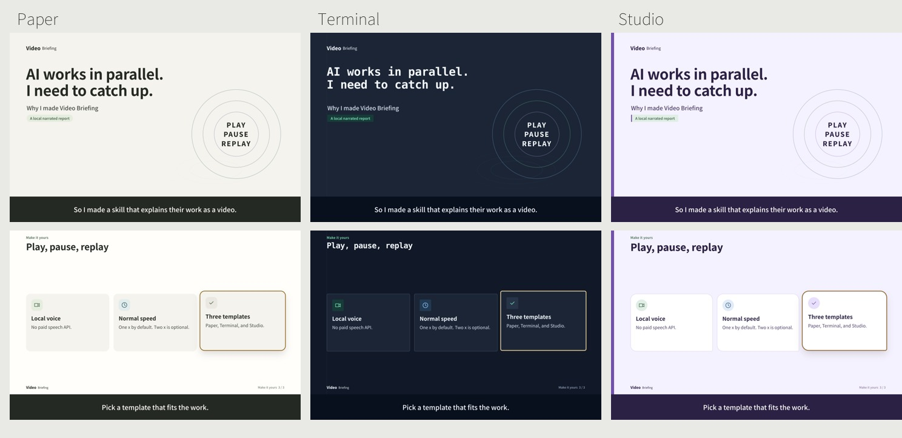

<h1 align="center">Video Briefing</h1>

<p align="center"><strong>Let your agents explain their work while you watch or listen.</strong></p>

<p align="center">
  <a href="https://github.com/gimjungwook/video-briefing-skill/releases/download/v0.1.0/video-briefing-paper-1x.mp4">Watch the 38-second demo</a> ·
  <a href="#quick-start">Quick start</a> ·
  <a href="#three-templates">Templates</a> ·
  <a href="https://otterworkspace.ai/">Otter Workspace ↗</a>
</p>

<p align="center">MIT code · Local voice &amp; rendering · 1x by default · Apple Silicon Macs</p>

## Your agents work in parallel. You still have to catch up.

My AI agents can work in parallel, but I still have to understand their results and revisions. I became the bottleneck. When I cannot focus on another long answer, playing a video and hearing it again helps me catch up.

This is the skill I use for that: a local narrated video with motion, captions, chapters and highlights timed to the explanation. It is a tool for understanding the work, not proof that the work is correct.

## What you get

- Narration with local Supertonic 3; Korean and English workflows.
- Word timing and ending checks with local Whisper.
- Motion scenes: comparisons, screenshots with camera movement, conversations, cards, flows, checklists, tables, code and counting numbers.
- Three templates: **Paper**, **Terminal**, **Studio**.
- **1x narration by default**, with an optional 2x setting.
- MP4 export, chapters, layout checks, loudness checks and review frames.

No paid speech or rendering API is required. Initial setup downloads models and dependencies. Your coding agent or chat service has its own costs; local hardware and electricity still apply. This is not a voice-cloning package.

## Three templates



| Paper | Terminal | Studio |
|---|---|---|
| Warm, bright pages with quiet green accents. | Dark backgrounds, crisp borders and monospace headings. | Colourful cards, rounded shapes and bold headings. |

Choose a look in your outline. Narration, captions and scene timing follow the same workflow.

## Also building: Otter Workspace 🦦

I’m building [**Otter Workspace**](https://otterworkspace.ai/) alongside this skill: **one workspace where every app works from one memory.**

[Memory](https://memory.otterworkspace.ai/) gives your AI a shared memory. [Docs](https://docs.otterworkspace.ai/), [Meetings](https://meetings.otterworkspace.ai/) and [Schedule](https://schedule.otterworkspace.ai/) bring documents, meeting decisions and plans into the same workspace. Connect the AI you already use: ChatGPT, Claude, Codex or Claude Code.

**[Explore Otter Workspace →](https://otterworkspace.ai/)**

Video Briefing runs independently. You don’t need an Otter account to use it.

## Quick start

The first release targets **macOS on Apple Silicon** because the transcription step uses MLX. Other systems are untested. You need Python 3.11+, Node 22+, Google Chrome and FFmpeg (`ffprobe` included). On a Mac with Homebrew:

```sh
brew install python@3.12 node ffmpeg
```

Clone the repository and install the Python dependencies:

```sh
git clone https://github.com/gimjungwook/video-briefing-skill.git
cd video-briefing-skill
python3.12 -m venv .venv
source .venv/bin/activate
python -m pip install -r requirements.txt
```

Read [THIRD_PARTY.md](THIRD_PARTY.md), then download the local model files and font. Downloads are stored in your cache, not in this repository:

```sh
python scripts/download_models.py --accept-model-licenses
python scripts/check_env.py
```

The Supertonic SDK is MIT licensed. Its model weights have a separate OpenRAIL-M license. Neither weights nor third-party executables are redistributed here.

## Make the demo

Keep the source example clean by copying it to an ignored working folder:

```sh
mkdir -p work/demo
cp examples/demo/outline.md work/demo/outline.md
python scripts/motion_kit.py work/demo
python scripts/make_audio.py work/demo
python scripts/briefing_video.py motion work/demo
python scripts/briefing_video.py verify work/demo
```

The result is `work/demo/out/briefing.mp4`. Review any `CHECK` lines in the audio report and open `work/demo/video/check/contact.png`. Verification samples are not a complete viewing/listening pass.

## Change speed or template

Normal speed needs no setting. For 2x narration:

```sh
printf '2\n' > work/demo/tempo.txt
python scripts/make_audio.py work/demo
python scripts/briefing_video.py motion work/demo
```

To return to 1x, write `1` to the same file. The file wins over `VB_TEMPO`; otherwise the default is 1x. Timing is recomputed with the audio.

Set `theme: paper`, `theme: terminal` or `theme: studio` in the outline frontmatter, rerun `motion_kit.py`, then render again. Theme changes do not require regenerating the speech. See [the outline reference](references/outline.md).

## Use as an agent skill

The repository root is the skill folder: `SKILL.md`, `scripts/`, `assets/` and `references/` travel together. Put a copy in your agent's skill directory and use its existing skill-discovery mechanism. For Codex, use `~/.codex/skills/video-briefing/`. Preserve any existing skill before replacing it. Restart the agent if required by your client.

Example request:

> Use the video-briefing skill to explain what changed, what you verified, and what I still need to decide. Use the Terminal template at normal speed.

Video reports are opt-in. To request them after each completed task, say so explicitly in your agent instructions. This does not grant permission to upload reports or publish social posts.

## Configuration

<details>
<summary>Paths, models, speed and render settings</summary>

| Variable | Purpose |
|---|---|
| `VB_FONT` | Local subtitle font file; defaults to the downloaded Noto Sans KR font |
| `VB_CHROME` | Chrome/Chromium executable; defaults to the usual macOS Chrome location |
| `VB_NODE` | Node executable; defaults to Node on `PATH` |
| `VB_SUPERTONIC_PY`, `VB_WHISPER_PY` | Python interpreters; default to the active interpreter |
| `VB_SUPERTONIC_CACHE` | Supertonic model folder |
| `VB_TEMPO` | Optional narration speed from 0.5 to 2; project `tempo.txt` takes priority |
| `VB_JOBS` | Parallel render processes; default uses up to four |

</details>

Treat projects as trusted local code: `cues.py` is executed by the renderer. Do not run an untrusted downloaded project without reviewing it.

## License

The original skill code and templates are MIT licensed. Third-party dependencies retain their own licenses; see [THIRD_PARTY.md](THIRD_PARTY.md).

Created by [Jungwook Kim](https://github.com/gimjungwook) · Building [Otter Workspace](https://otterworkspace.ai/).
